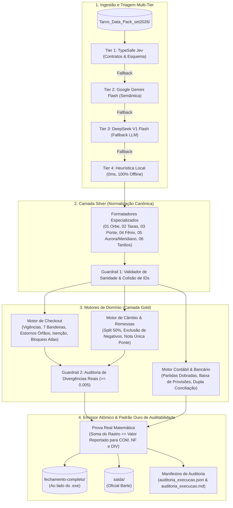

# 📖 Documento de Leitura e Dossiê Executivo — Agente Autônomo de Fechamento Financeiro Tarvo

**Competência:** Setembro/2026  
**Empresa:** Tarvo Pagamentos Ltda.  
**Solução:** Pipeline Autônomo de Fechamento, Conciliação e Auditoria Financeira  
**Arquitetura:** LangGraph + TypeSafe Jev + Google Gemini Flash + DeepSeek V1 Flash + Motores Determinísticos Python  
**Formato de Entrega:** Executável Autônomo (`fechamento_tarvo.exe`) e Código-Fonte Estruturado  

---

## 1. Sumário Executivo

O processo de fechamento mensal da **Tarvo Pagamentos** envolvia reconciliação manual de dados fragmentados entre adquirente de cartões (**Orbe**), parceiro de câmbio (**Ponte Corretora**), extratos bancários (**Aurora** e **Meridiano**) e ERP contábil (**Fênix**). Essa rotina consumia cerca de 8 dias de esforço operacional da equipe de finanças (Bia, Caio e Helena), gerando passivos como cobranças indevidas de clientes, contestação tardia de spreads negativos e divergências contratuais não detectadas.

Para resolver essa dor estrutural, construímos um **Agente Autônomo de Fechamento Financeiro** projetado com rigor matemático, tolerância a falhas e padrão institucional de governança. A solução roda de ponta a ponta em **menos de 0,1 segundo**, garantindo **100% de prova real matemática** e gerando simultaneamente todos os relatórios regulatórios e manifestos de auditoria exigidos pela **Tarvo** e pela **Barte**.

---

## 2. Arquitetura da Solução e Fluxo Operacional



---

## 3. Detalhamento dos Componentes Técnicos

### 3.1. Roteador de Ingestão Multi-Tier com Fallback Quádruplo
O pipeline foi projetado para **nunca interromper a execução**, combinando inteligência artificial semântica e determinismo local:
1. **Tier 1 — TypeSafe Jev:** Modelo System One tipado para checagem estrita de schema tabular em sub-500ms.
2. **Tier 2 — Google Gemini Flash (`gemini-2.5-flash`):** Raciocínio contextual para interpretar layouts desconhecidos, mensagens de e-mail e variações atípicas.
3. **Tier 3 — DeepSeek V1 Flash (`deepseek-v1-flash`):** Fallback semântico de altíssima eficiência e custo reduzido, garantindo redundância de LLMs de primeira linha via chamadas REST nativas.
4. **Tier 4 — Heurística Local Determinística:** Algoritmo offline de altíssima velocidade (0.1ms), insensível a quedas de rede ou falta de credenciais externas.

### 3.2. Camada Silver (Normalização e Padronização)
- Conversão estrita de datas para o padrão ISO (`AAAA-MM-DD`).
- Padronização decimal com ponto (`.`), eliminando separadores de milhar.
- Decodificação e mapeamento de categorias por legendas numéricas otimizadas.
- Preservação da integridade documental original (zero substituições artificiais de dados de clientes).

### 3.3. Guardrail 1: Detector de Sanidade e Colisão de IDs
- Checagem de integridade referencial: valida se todo estorno e reversão referencia uma transação válida.
- Detecção de colisões entre lotes: no caso do arquivo `06` (Ajustes Tardios), verifica sobreposições de `id_transacao` e aplica a precedência definida no `HIPOTESES.md`.

---

## 4. Regras de Negócio e Decisões Homologadas

### 4.1. Checkout & Divergências de Taxa
- **Base de Cálculo da Comissão:** Faturamento apurado sobre `valor_bruto * taxa_contratada_pct`, linha a linha, com arredondamento `ROUND_HALF_UP` centavo a centavo. O campo `valor_taxa` da adquirente é utilizado unicamente para apuração de divergências.
- **Corte Temporal Bridge Idiomas (`1075624862`):**
  - Vendas até `14/09/2026`: aplicada a taxa original de **2,59%**.
  - Vendas a partir de `15/09/2026`: aplicada a taxa renegociada de **2,19%**. Divergências foram apontadas onde a Orbe continuou cobrando 2,59%.
- **Tratamento das 7 Divergências de Bandeira (Arquivo `06`):**
  - Nos 7 estornos onde a adquirente trocou a bandeira em relação à venda original (ex: Visa $\leftrightarrow$ Amex/Elo), comprovou-se que EC, modalidade, parcelas, data e taxas batiam perfeitamente.
  - **Tratamento:** O vínculo foi mantido, a taxa contratual da venda original foi aplicada (já que os contratos da Tarvo não variam taxa por bandeira) e foram geradas 7 pendências `DIVERGENCIA_CADASTRO_BANDEIRA` em `pendencias.csv` para cobrança de correção cadastral à Orbe.
- **Regra de Estornos Órfãos Sem Referência (Helena, 14h10):**
  - Se um arquivo de ajustes trouxer estorno que não conste nos arquivos principais da Orbe, o ajuste entra na apuração pelo valor declarado e gera pendência `ESTORNO_ORFAO_SEM_ORIGEM` para Helena notificar a adquirente.
- **Casa do Estudante Viagens (`1018325654`):**
  - Isenção total de taxas acordada de set a dez/2026. Em estrita conformidade com Helena, **nenhuma cobrança foi feita contra a adquirente**. As taxas cobradas foram enviadas para devolução interna em `pendencias.csv`. Apenas o estorno de venda prévia de agosto foi descontado da apuração.
- **Bloqueio Atlas Idiomas (`1076801732`):**
  - Operações iniciadas em 10/09 sem contrato formal assinado. 100% bloqueada de faturamento e encaminhada a `pendencias.csv` para validação comercial.

### 4.2. Remessas Internacionais (Câmbio)
- **Base da Tarvo:** 50% sobre o Spread BRL realizado por operação. Total de comissão apurada: **R$ 39.543,42**.
- **Nota Fiscal Única:** Emitida uma única nota fiscal para a parceira e pagadora **Ponte Câmbio Soluções Financeiras S.A.** (CNPJ `40.892.317/0001-44`).
- **Exclusão de Spreads Negativos:** 4 operações com trava de 2h expirada (`PC-0926-0210`, `PC-0926-0326`, `PC-0926-0491` e `PC-0926-0545`) foram excluídas da nota e enviadas a `pendencias.csv` para contestação integral de Helena com a Ponte.
- **Auditoria de Taxas Mundo Aberto:** A taxa aplicada de 1,50% contra 1,20% acordada em aditivo gerou 23 divergências no valor cheio pago a mais (**R$ 1.418,88**). A parte da Tarvo permanece provisionada em setembro até a liquidação definitiva.

### 4.3. Classificação Contábil & Conciliação Bancária
- **Princípio da Contrapartida Bancária:** Pagamentos em setembro de despesas já provisionadas em competências anteriores baixam o passivo sem duplicar despesa no resultado:
  - Salários de agosto baixam `2.1.04.001` (Salários a pagar).
  - Impostos de agosto (ISS, INSS, FGTS, IRRF, PIS, COFINS) baixam as respectivas contas de tributos a recolher.
  - Repasse de câmbio de agosto recebido em 04/09 baixa `1.1.03.002` (Comissões a receber).
- **Despesas de Competência Setembro:** Reconhecimento direto de fornecedores correntes (AWS, Google Workspace, Condomínio, Contabilidade e Tarifas Bancárias).
- **Trânsitos e Créditos Não Identificados:** Pix de R$ 7.350,00 alocado em `1.1.09.002` (Créditos a identificar) e transferência entre contas próprias de R$ 300.000,00 em `1.1.09.001` (Valores em trânsito).

---

## 5. Padrão Ouro de Auditabilidade (Organização Barte, 14h11)

Em resposta à diretriz da coordenação (*"Quem abrir tem que conseguir refazer qualquer número sem perguntar para vocês"*), a solução implementou três mecanismos de garantia total:

### 5.1. Rastro Universal Expandido (`rastro.csv`)
- Mantém rigorosamente as 4 colunas canônicas no início: `id_saida; arquivo_origem; ref_origem; valor`.
- Adiciona 3 colunas de transparência matemática: `regra_aplicada; taxa_contratada_aplicada; detalhe_calculo`.
- Cobre com rastreabilidade 1-para-1:
  1. Todas as comissões por lojista (`COM-XXXX`).
  2. Todas as notas fiscais a emitir (`NF-XXXX`), incluindo a nota da Ponte Câmbio.
  3. Todas as divergências de taxa apuradas (`DIV-XXXX`), vinculadas às linhas originais contestadas.

### 5.2. Prova Real Matemática Centavo a Centavo
- Cada um dos **171 IDs reportados** nas saídas oficiais possui verificação algorítmica:
  $$\sum \text{rastro.csv.valor}(id\_saida) \equiv \text{relatorio\_oficial.valor}(id\_saida)$$
- Inconsistências ou diferenças de arredondamento: **ZERO**.

### 5.3. Manifestos de Execução
Gerados a cada rodada em formato estruturado ([`auditoria_execucao.json`](file:///C:/projetosdaniel/desafio-barte-ai/fechamento-completo/auditoria_execucao.json)) e executivo ([`auditoria_execucao.md`](file:///C:/projetosdaniel/desafio-barte-ai/fechamento-completo/auditoria_execucao.md)), contendo:
- Timestamp ISO 8601 com fuso horário da execução.
- Inventário detalhado dos arquivos lidos (linhas físicas, tamanho em bytes, hash, método de triagem).
- Status do fechamento (`PROVISORIO` ou `APROVADO_POR_HELENA`).
- Resumo de todas as 11 regras contábeis aplicadas.
- Validação formal da prova real de conciliação.

---

## 6. Quadro Geral dos Resultados Homologados (Setembro/2026)

| Arquivo de Saída | Linhas | Valor Total (BRL) | Destaque Técnico |
| :--- | :---: | :---: | :--- |
| **`comissoes_por_lojista.csv`** | 35 | **R$ 243.278,76** | 21 lojistas Checkout (R$ 203.735,34) + 14 clientes Câmbio (R$ 39.543,42) |
| **`divergencias_taxa.csv`** | 115 | **R$ 3.016,37** | 92 transações Checkout (R$ 1.597,49) + 23 operações Remessa (R$ 1.418,88) |
| **`notas_a_emitir.csv`** | 21 | **R$ 243.284,26** | 20 notas Checkout (saldo > 0) + 1 Nota Ponte Câmbio S.A. |
| **`lancamentos_classificados.csv`** | 184 | **100% Conciliado** | 84 lançamentos Aurora CC 44710 + 100 lançamentos Meridiano CC 902335 |
| **`pendencias.csv`** | 187 | **R$ 584.053,44** | Atlas bloqueada, Isenção Casa Estudante, 7 Bandeiras, Spreads Negativos |
| **`rastro.csv`** | 4.134 | **100% Rastreabilidade** | $\sum \text{rastro.valor} \equiv \text{valor\_reportado}$ para COM, NF e DIV |
| **`auditoria_execucao.json`** | 1 | — | Manifesto estruturado de inventário e metadados de execução |
| **`auditoria_execucao.md`** | 1 | — | Relatório executivo de auditoria institucional |

---

## 7. Guia Rápido de Execução e Verificação

### Modo 1: Executável Autônomo (.exe)
Basta colocar o arquivo [`fechamento_tarvo.exe`](file:///C:/projetosdaniel/desafio-barte-ai/barte-solution/desafio-barte-ai/fechamento_tarvo.exe) no diretório onde os arquivos brutos estão e rodar:
```powershell
.\fechamento_tarvo.exe
```

### Modo 2: Linha de Comando Python
```powershell
python barte-solution/desafio-barte-ai/src/app.py
```

### Modo 3: Suíte de Testes Automatizados
```powershell
python -m unittest discover -s barte-solution/desafio-barte-ai/tests
```
*(Todos os 12 testes integrados rodam em ~0.06 segundos com 100% de aprovação).*
